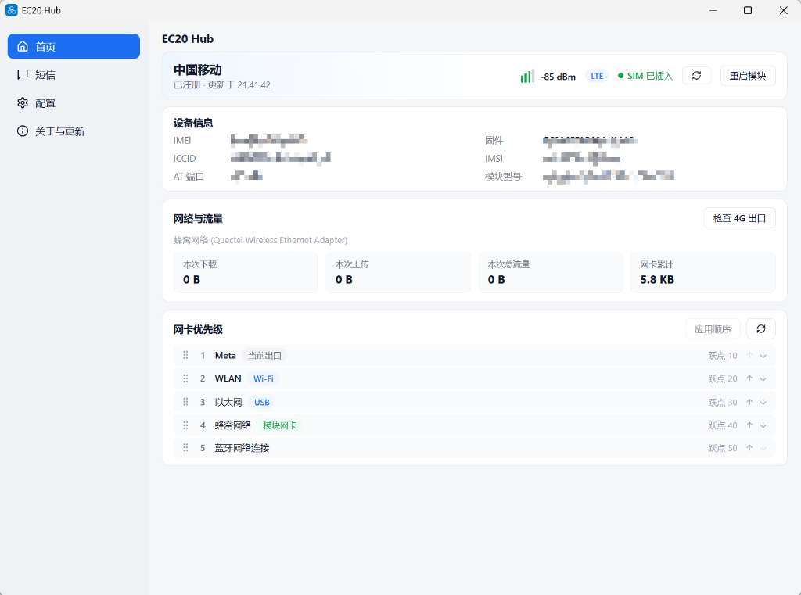

# EC20 Hub

适用于 **Quectel EC20 / EC25** 4G 模块的 Windows 桌面管理工具，基于 **Tauri v2 + Rust + Vue 3** 构建。



## 核心功能

- **模块状态监控**：自动识别移远 AT 串口（`VID_2C7C & PID_0125`），实时展示运营商、网络注册状态、信号强度（dBm / 格数）、网络制式、SIM 卡状态、IMEI、固件版本、ICCID 与 IMSI。
- **短信收发与归档**：
  - 支持 GSM 7-bit 与 UCS2 中文 PDU 编解码及 UDH 长短信分段重组；
  - 自动提取短信验证码，支持一键复制；
  - 支持「接管模块短信」模式：自动归档至本机并清理 SIM 卡与模块存储，避免容量满后拒收；
  - 支持会话分组、全文搜索、短信发送与 Windows 系统通知提醒。
- **网络与流量监控**：
  - 自动匹配 Quectel / RMNET / MBIM 网卡，统计本次会话与网卡累计收发流量；
  - 一键「检查 4G 出口」查看网卡 IPv4 地址与网关状态。
- **网卡优先级调整**：
  - 读取 Windows 网络适配器及 IPv4 接口跃点数（`InterfaceMetric`），标注当前默认出口与模块网卡；
  - 支持拖拽或按钮调整网卡顺序并一键应用。
- **系统托盘与配置**：
  - 关闭主窗口默认最小化到系统托盘后台运行；左键托盘图标弹出右下角状态悬浮窗，右键可打开主界面、立即同步短信或退出；
  - 支持浅色 / 深色 / 跟随系统主题切换；
  - 支持通过 Windows 计划任务（最高权限）静默开机自启与启动时最小化到托盘。

## 环境要求

- **操作系统**：Windows 10 / Windows 11（需安装移远 USB 驱动）
- **开发环境**：
  - [Node.js](https://nodejs.org/) >= 18
  - [Rust](https://www.rust-lang.org/)（stable toolchain）
  - Microsoft Edge WebView2 Runtime（Windows 10/11 通常已预装）

## 本地开发与构建

```powershell
# 安装前端依赖
npm install

# 启动开发环境（前端 + Rust 后端）
npm run tauri dev

# 构建安装包
npm run tauri build
```

> **提示**：由于软件清单配置了 `requireAdministrator`（用于调整网卡跃点数与配置开机自启），开发模式下如需测试修改网卡优先级或开机自启，请使用管理员权限打开终端运行 `npm run tauri dev`。

## 技术栈

- **桌面框架**：[Tauri v2](https://v2.tauri.app/)
- **后端**：Rust（`serialport`、`sysinfo`、`tokio`、`serde`、`chrono`、`regex`）
- **前端**：Vue 3 + TypeScript + Vite + Lucide Icons

## 开源协议

本项目基于 [MIT License](LICENSE) 开源。
